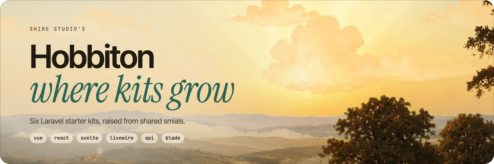

<picture>
    <source media="(prefers-color-scheme: dark)" srcset="art/header-dark.png">
    
</picture>

<br/>
<br/>

# Hobbiton

Hobbiton is where every Shire Studio Laravel starter kit is grown. Each kit is raised from a stack of shared **smials**, so a fix made once reaches every kit that shares it. When a change lands on `main`, the **quick post** opens a pull request on each kit's repository.

## The Kits

| Kit | Stack | Repository |
| --- | --- | --- |
| Vue | Inertia, Vue 3, shadcn-vue, Fortify | [shire-studio/laravel-starter-kit-vue](https://github.com/shire-studio/laravel-starter-kit-vue) |
| React | Inertia, React 19, shadcn/ui, Fortify | [shire-studio/laravel-starter-kit-react](https://github.com/shire-studio/laravel-starter-kit-react) |
| Svelte | Inertia, Svelte 5, shadcn-svelte, Fortify | [shire-studio/laravel-starter-kit-svelte](https://github.com/shire-studio/laravel-starter-kit-svelte) |
| Livewire | Livewire 4, Flux, Fortify | [shire-studio/laravel-starter-kit-livewire](https://github.com/shire-studio/laravel-starter-kit-livewire) |
| API | Sanctum tokens, JSON resources | [shire-studio/laravel-starter-kit-api](https://github.com/shire-studio/laravel-starter-kit-api) |
| Blade | Blade views and Tailwind CSS, landing page only | [shire-studio/laravel-starter-kit-blade](https://github.com/shire-studio/laravel-starter-kit-blade) |
| API Teams | The API kit with teams, delivered as an overlay of the API repository | None, ships with API |

Every kit ships the same tooling: Pint (PHP and Blade), Rector, PHPStan at level max, Pest with 100% code and type coverage, Laravel Vet, Boost guidelines and the `.ai` rules. Kits with a frontend add Vite Plus (oxlint and oxfmt) and a TypeScript check.

## Smials

A smial is a folder under `smials/` holding part of a kit. Raising a kit copies its smials in order, so a later smial overrides a file from an earlier one.

| Smial | Holds | Raised into |
| --- | --- | --- |
| `common` | Config, tooling, CI, AI rules and the base test suite | Every kit |
| `auth` | Actions, form requests, models, rules, factories and their unit tests | Vue, React, Svelte, Livewire, API |
| `web` | Session controllers and feature tests that never render a page | Vue, React, Svelte, Livewire |
| `inertia` | Controllers, routes, middleware, Data classes and feature tests | Vue, React, Svelte |
| `inertia-vue`, `inertia-react`, `inertia-svelte` | The frontend, its tooling, its artwork and its lock files | One kit each |
| `livewire` | Controllers that return Blade views, Livewire components, Flux views and the artwork | Livewire |
| `api` | JSON controllers, Sanctum, the API tests and the artwork | API |
| `blade` | The landing page and the artwork | Blade |
| `teams` | Team models, enums, policy, rules, actions, notification, migrations, factories and their unit tests | Every team kit |
| `teams-api` | Team JSON controllers, resources, routes and API feature tests | API Teams |

`hobbiton.json` lists every kit with its smials, the files it leaves out and the `{{placeholders}}` it fills in. A team kit also names its `base` kit. `raise`, `tend`, `survey`, `deliver` and both CI workflows read it.

The three Inertia kits use the same page names (for example `auth/Login`), so their `app`, `routes` and `tests/Feature` folders are identical byte for byte. Hobbiton's own test suite checks that.

## Getting Started

> Requires PHP 8.5+, Composer, Node 22+ and pnpm.

```bash
composer install
pnpm install
cp .env.example .env
php artisan key:generate
```

## The Commands

| Command | What it does |
| --- | --- |
| `php artisan raise --kit=react` | Raise a kit into `raised/react`, keeping its `vendor`, `node_modules`, `.env` and database |
| `composer tend -- --react` | Run the raised kit with `composer dev` and copy every change back into `smials/` |
| `composer tend -- --react --once` | Copy changes back once, without serving or watching |
| `composer survey` | Raise every kit and run its full `composer test` |
| `composer survey -- --api --tend` | Survey only the API kit, then copy lock files and tool fixes back |
| `composer harvest` | Update the dependencies of every kit and of Hobbiton, then survey every kit |
| `composer harvest -- --api` | Harvest only the API kit, then survey it and its team kit |
| `composer deliver -- --vue` | Mirror a kit into a local checkout of its repository, without committing |
| `php artisan pack --kit=api --to=dir` | Raise a base kit and write its team overlay into `.starter-kit/teams/` |
| `composer overrides` | Check `team-overrides.json` against the base files the team smials replace |
| `composer overrides -- --accept` | Refresh `team-overrides.json` after a deliberate change |

### Tending a Kit

```bash
php artisan raise --kit=react
composer tend -- --react
```

Edit `raised/react` like any Laravel app. Tend copies each change to the most specific smial that already owns the file and puts new files in the kit's top smial. Placeholders such as `{{kit}}` are restored on the way back. To share a file between more kits, move it to a lower smial yourself and raise again.

> [!WARNING]
> Stop `tend` before raising the same kit again. Raising clears the kit's files, and a running tend would copy those deletions into `smials/`.

## Team Kits

A team kit is a kit with a `base`, such as `api-teams`, whose base is `api`. It is raised from its base kit's smials with the team smials added last, so team files win. A team kit has no repository of its own. It ships inside its base kit as an **overlay**.

The overlay lives in `.starter-kit/teams/` in the base kit's repository. `manifest.json` holds `{"version": 1, "deleted": [...]}`, and `files/` holds every file the team kit adds or changes. Applying it means copying `files/` over the project, removing the `deleted` paths, then removing `.starter-kit/`. `php artisan pack --kit=api --to=dir` raises the base kit and writes the overlay into it. Packing a team kit is refused, so pack its base kit instead. `raise` never writes the overlay.

Team kits share their base kit's lock files and `vet.json`, because teams add no dependencies.

### Tending a Team Kit

Tend writes a team kit's changes only into team smials, so team code never reaches the base kits by accident. A change to a file that only a base smial owns is copied into the team smial as an override, and tend warns with the base file's name. To change the base kits, tend the base kit instead.

Every override of a base file is recorded in `team-overrides.json`, with a hash of the base file it replaced. After you change a base file that a team smial overrides, run `composer overrides`. It lists overrides whose base file moved on, so you can bring the team copy up to date, and then `composer overrides -- --accept` refreshes the ledger.

### Surveying

`composer survey` raises each kit, team kits included, into `raised/<kit>`, installs it, migrates it, builds its assets and runs its own `composer test`. Installs are kept between surveys, so only the first survey of a kit is slow.

### Harvesting

`composer harvest` is the weekly dependency update. Run it in a terminal, since Vet asks questions along the way. It works in two phases, so every question comes first and you can walk away while the kits are tested.

1. **Update.** Hobbiton itself (on a full run) and then each kit runs `composer update`, `composer bump` and, for kits with a frontend, taze for patches and minors followed by `pnpm update`. Each kit is updated in `raised/<kit>` and tended back into `smials/`.
2. **Survey.** Every updated kit and its team kit are surveyed with `--tend`, and Hobbiton's own `composer test` runs on a full run.

Team kits are not updated, since they share their base kit's lock files. They are surveyed after their base kit.

Vet asks about each new release once per run. A release you trust in one kit is trusted in every later kit that installs it. A release you leave unticked is held at its current version in every kit for the rest of the run, and the rest of the update goes ahead.

Nothing that needs a decision is applied. At the end, harvest lists the majors (including a minor of a `0.x` package), the deliberate holds such as `laravel/framework ~13.34.0` and the `vite-plus` catalog pin with what is available, the releases you declined, any difference between the Inertia kits' PHP versions, and `minimumReleaseAgeExclude` entries that no longer match a locked version. Upgrade those by hand.

Harvest refuses to start when a kit in `raised/`, or its team kit, has changes that are not yet in `smials/`, since raising would destroy them. It never commits, so review the changes and commit them yourself.

### Delivering

`composer deliver -- --vue` packs the Vue kit with its team overlay, if it has one, and mirrors it into `../laravel-starter-kit-vue` (or the folder in `HOBBITON_DELIVER_DIR`). With no flags it delivers every base kit. Asking for a team kit such as `--api-teams` is an error, since it is delivered with its base kit. It keeps that checkout's `.git`, `.env`, `vendor` and `node_modules`, and never commits or pushes.

## Lock Files and Vet

Each kit keeps its own `composer.lock`, `pnpm-lock.yaml` and `vet.json` in its top smial, since the kits resolve different packages. The Inertia kits share `vet.json` in `inertia` because their PHP dependencies are identical. Run `composer harvest` for the routine update. After changing a `composer.json` or `package.json` by hand, run `composer survey -- --tend` to refresh the lock files.

## Artwork

Every kit has its own README header in `art/` of its top smial, and Hobbiton's own header lives in `art/` at the root. `header-light.png` and `header-dark.png` are 2400 by 800 renders with a transparent background, painted with the layered landscape from the website hero: the afternoon painting for light and the moonlit one for dark. They are rendered outside this repository, so replace both files together when a tagline or the chips change.

## The Quick Post

Merging to `main` runs the **quick post** workflow. It packs every base kit, with its team overlay, and opens a pull request on the kit's repository from the `hobbiton/quick-post` branch, titled with the merged commit message. While that pull request is open, later posts add commits to it instead of opening another, so merging it brings the kit up to date with Hobbiton. Kits with nothing to change get no pull request. Team kits get no pull request of their own, since their changes arrive in the base kit's pull request.

Each kit's `main` stays protected, and its own **tests** workflow checks the pull request before it is merged. To post only some kits, run the workflow by hand with a comma separated `kits` input such as `react,svelte`.

The workflow needs a `STARTER_KIT_TOKEN` secret that can push branches and open pull requests on every kit repository (for a fine grained token, **Contents** and **Pull requests** set to read and write). Releases still happen in each kit repository through its own **release** workflow.

## License

Hobbiton and the starter kits are open source software licensed under the [MIT license](smials/common/LICENSE.md).
